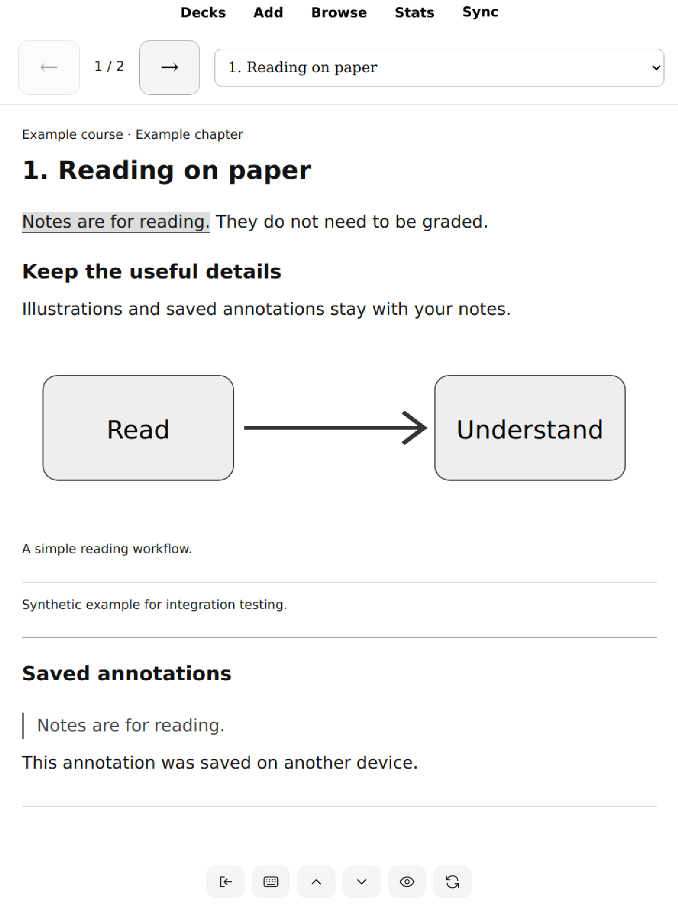

# Paper Anki

The full ARM64 Anki desktop application, running locally on a reMarkable Paper Pure and opened from AppLoad. No laptop is needed while studying. AnkiWeb sync uses Anki's normal account and collection handling.

This is a community integration, not an official reMarkable or Anki product. The first version is a tested development release for one specific hardware/firmware combination.

## What works

- AppLoad launch and return to the reMarkable interface.
- Full Anki deck browser, review, Add, Browse, editing, and sync.
- A larger interface at 125% scale, with the desktop menu bar hidden.
- Plain white tablet presentation: no mountain wallpaper, dark card panels, shadows, or CSS animations. Synced templates and laptop appearance are not changed.
- Touch forwarded to Anki, including dragging and text selection; the desktop cursor is hidden.
- A compact SVG toolbar for exit, keyboard, scroll up/down, reveal/space, and refresh.
- A read-only reader for `::Notes` decks: page arrows, chapter picker, illustrations, image enlargement, and existing annotations. Opening these pages does not review or unsuspend their cards.

The screenshot contains only the synthetic test fixture included in this repository.

## Validated configuration

| Component | Version |
|---|---|
| Tablet | reMarkable Paper Pure, ARM64 |
| Firmware | 3.29.0.153 |
| Tablet Qt | 6.10.3 |
| Anki | Official 26.09.3 Linux ARM64 |
| Userspace | Ubuntu Base 24.04.4 ARM64 |
| XOVI bundle | rm-xovi-extensions v19-23052026 |
| AppLoad | v0.6.0 |
| Build SDK | reMarkable 3.28.0.172 / Qt 6.10.3; resulting plugin also tested on the firmware above |

Earlier bring-up used firmware 3.28.0.172. Its resource hash table must not be reused on 3.29. This release's installer intentionally accepts only 3.29.0.153. Other devices and firmware need separate validation.

## Get started

See [installation and build instructions](docs/INSTALL.md). Developer Mode, SSH access, several GB of free storage, and a working AppLoad installation are required. This is currently a manual development installation, not a one-click consumer package.

Open **sidebar → AppLoad → Anki**. Sign in with the **Sync** button. On a fresh empty tablet profile, download the existing AnkiWeb collection when Anki asks which copy to retain. Wait for media sync before going offline.

For reading, expand a course and select its **Notes** deck. Use the arrows or chapter picker to change pages, the toolbar arrows to scroll, and tap an illustration to enlarge it. Tap a highlighted passage to jump to its saved annotation. Annotation editing stays on the laptop; the tablet reader does not write annotations.

The toolbar's eye sends Space: it reveals an answer during review and advances a page in the Notes reader. Return closes the app gracefully. If Anki has an unsaved editor or a sync dialog, reopen it to complete that dialog.

After reboot, the normal reMarkable interface starts first. Run `/home/root/xovi/start` over SSH to enable AppLoad, or install the optional power-button shortcut described in the installation guide. XOVI is deliberately not injected automatically at boot.

## Documentation

- [Install, build, update, optional shortcut](docs/INSTALL.md)
- [Architecture, data, security boundaries](docs/ARCHITECTURE.md)
- [Recovery and firmware updates](docs/RECOVERY.md)
- [Validation results and repeatable checks](docs/TESTING.md)
- [Third-party software and attribution](THIRD_PARTY.md)

## Limits

This remains desktop Anki on an e-ink screen. Fast animation, video, audio, handwriting input, and desktop-grade scrolling are not provided or validated. The small on-screen keyboard is intended for short input; it does not yet include every symbol or compose sequence. CSS overrides target the bundled study layouts; arbitrary third-party card scripts may need their own adaptation. AppLoad's gesture and device sleep behavior remain part of the host interface. Long battery-life, extended sleep/wake, and physical triple-press testing are still outstanding.

Source, build scripts, a synthetic test fixture, and recovery instructions are included. Account credentials, personal collections, real study materials, review logs, and firmware-derived hash tables are not included. Original integration code is GPL-3.0; dependencies retain their own licenses.
